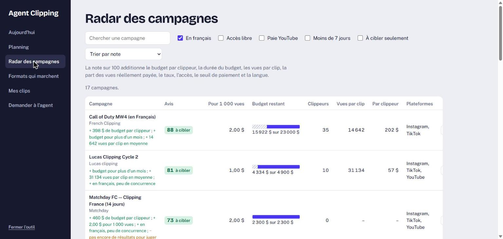
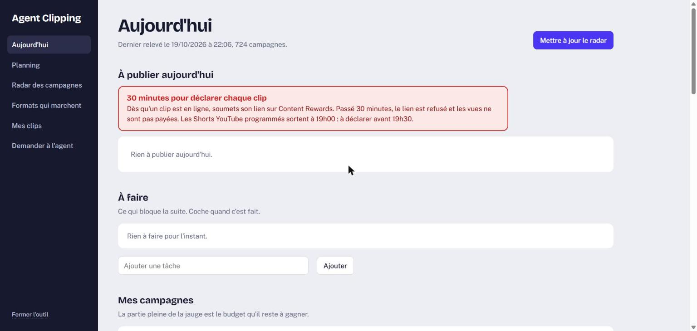

# Radar Clipping

Outil de veille et tableau de bord pour les campagnes de **clipping rémunéré** (Content Rewards / Whop). Il relève toutes les campagnes publiques, calcule ce qu'un clippeur y gagne réellement et les classe avec une note d'intérêt sur 100.

Projet personnel développé en Python avec l'IA générative (Claude Code).



## Le problème

Des centaines de campagnes paient des créateurs pour publier des extraits vidéo, chacune avec son propre taux pour 1 000 vues. Le taux affiché est trompeur : plafonds, seuils de paiement et vues non retenues font que le montant réellement payé est souvent bien plus bas. Trier ces campagnes à la main prend des heures.

## Ce que fait l'outil

- **Collecte** (`radar/collect.py`) : récupère toutes les campagnes publiques via l'API de la page Discover (lecture seule, sans compte, une requête par seconde), et garde une copie datée de chaque relevé.
- **Classement** (`radar/classement.py`) : calcule pour chaque campagne le budget restant, le nombre de jours de budget au rythme actuel, les vues par clip, le gain par clippeur et le taux **réellement payé**. Il détecte aussi la langue de la campagne. Résultat : un rapport `RADAR.md` et un tableau `campagnes.csv`.
- **Note d'intérêt sur 100** : un score transparent qui additionne le budget par clippeur, la durée du budget, les vues par clip, la part des vues réellement payée, le taux, l'accès libre, le seuil de paiement et la langue. Chaque note s'accompagne des raisons (+ / −).
- **Tableau de bord local** (`agent/`) : une application web servie sur `127.0.0.1` uniquement, avec le radar filtrable, l'évolution depuis le dernier relevé, un planning de publication, une liste de tâches et le suivi des campagnes choisies.
- **Analyse des formats** (`analyse/`) : récupère les clips les mieux payés, mesure leur durée, leur rythme de coupes et la présence d'une voix (FFmpeg, faster-whisper), pour savoir quels formats marchent par plateforme.



## Exemple de résultat

Sur un relevé de 710 campagnes (octobre 2026), le taux médian affiché était de 1 $ pour 1 000 vues, mais le taux réellement payé n'était que d'environ 0,50 $. Le gain médian était d'environ 33 $ par clippeur et par campagne.

## Lancer le projet

Python 3.10 ou plus. Le radar et l'application n'utilisent que la bibliothèque standard.

```bash
python radar/collect.py        # relève les campagnes
python radar/classement.py     # produit RADAR.md et campagnes.csv
python agent/app.py            # ouvre le tableau de bord sur http://127.0.0.1:8765
```

Sous Windows, `radar/maj.ps1` enchaîne les deux premières étapes.

L'analyse des formats demande en plus FFmpeg et `pip install -r requirements.txt`.

## Sécurité

- Le serveur n'écoute que sur `127.0.0.1` et refuse toute requête dont l'en-tête `Host` n'est pas local.
- Les actions (mise à jour, tâches, suivi) exigent un jeton aléatoire, recréé à chaque lancement.
- Les chemins de fichiers reçus sont validés pour rester dans le dossier du projet.

## Limites

- Outil non officiel : il dépend d'une API publique qui peut changer sans prévenir.
- La note d'intérêt est une aide au tri, pas une prévision de gains.
- Les données collectées et les fichiers personnels ne sont pas dans ce dépôt (voir `.gitignore`).

## Auteur

Gabriel Richet, étudiant en Bachelor Numérique et Management à l'ESIEE Paris. [LinkedIn](https://www.linkedin.com/in/gabriel-richet9/)
